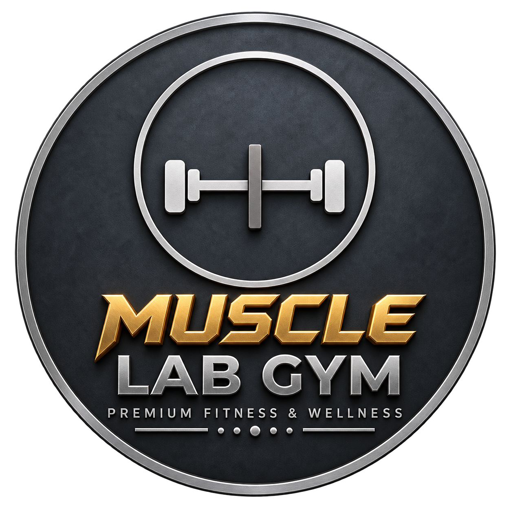

<div align="center">

  

  <h1 align="center" style="letter-spacing: 0.08em; text-transform: uppercase;">
    MUSCLE LAB FITNESS
  </h1>

  <p align="center">
    <strong>The Architecture of Elite Performance.</strong><br />
    <em>Awwwards-Tier Showcase &amp; Multi-Page Web Platform for Central India’s Premier Private Athletic Club.</em>
  </p>

  <p align="center">
    <a href="https://maps.app.goo.gl/6RtbrFD79c9cikYP9?g_st=ic" target="_blank">
      
    </a>
    <a href="https://instagram.com/musclelabjbp" target="_blank">
      
    </a>
    
    
    
  </p>

</div>

---

## 🏛️ Executive Summary & Vision

**Muscle Lab Fitness** (`1st Floor, Jain Heights, Opposite Saptrishi Hospital, Wright Town, Jabalpur, MP 482002`) is a private athletic sanctuary engineered to redefine fitness standards in Central India. Founded by **Advocate Harsh Jain**, Muscle Lab bridges the gap between ultra-luxury aesthetics and raw, uncompromising heavy-iron training.

This web application is an Awwwards/FWA-caliber digital showcase built to pitch the gym's elite standards to prospective high-net-worth members, competitive physique athletes, and prospective franchise investors.

---

## ✨ Key Architectural Highlights

### 1. 4K Cinematic Background Engine
- Integrated ultra-high-definition 4K background video (`Muscle_Lab_Remix_4K.mp4`) calibrated with subtle charcoal and gunmetal vignetting.
- Live interactive HUD camera switcher (`CAM 01 // 4K REMIX`, `CAM 02 // HEAVY RACK`, `CAM 03 // PRO GEAR`).
- Ambient audio controller with live playback toggles.

### 2. Certified & Endorsed by Kai Greene (@kaigreene)
- Official IFBB Legend certification section showcasing bio-mechanical machinery specifications:
  - **99.4% Peak Torque Retention** throughout the ascending resistance curve.
  - **450KG+ Machine Capacity** with 11-gauge structural steel and industrial pillow-block bearings.
  - **Pure Hypertrophic Vector Paths** eliminating momentum cheating and secondary muscle takeover.
- Interactive telemetry switcher comparing mechanical tension, load ratings, and isolation indexes.

### 3. Mobile-First Optimization & Horizontal Snap Flows
- Designed specifically for smartphone-first consumption (iPhone SE 375px, iPhone 14/15/16 390px, Pro Max 430px, iPad).
- **Kai Greene Section:** Badges automatically tuck into a fluid touch-snap swipe track (`flex overflow-x-auto snap-x`) beneath the portrait on mobile, preventing portrait overlap.
- **Instagram Live Feeds:** 4 high-definition video reels (`@musclelabjbp`) switch into a horizontal swipe carousel on mobile.
- **Verified Member Endorsements:** Athlete and surgeon reviews transition into a horizontal snap carousel on mobile viewports.
- Zero horizontal layout break or unwanted viewport overflow.

### 4. Interactive Pre-Loader & Custom Dumbbell Cursor
- **Pre-Loader:** High-precision tracking animation assembling the golden letters of `MUSCLE LAB` with metallic sheen glints, accompanied by a session-aware cache.
- **Custom Cursor:** Custom-forged SVG dumbbell tracking cursor with dynamic rotation, metallic glow aura, and interactive expansion states upon hovering actionable buttons.

### 5. Multi-Page Architecture & Portals
- **`/` (Showcase):** Hero engine, Kai Greene biomechanics, Instagram live feed, bento grid facility zones, founder spotlight, verified endorsements, operational hours, interactive Wright Town map.
- **`/facilities`:** Deep-dive zone catalog with 5 specialized areas (Heavy Iron, Dumbbell Arsenal up to 70KG pairs, Cardio Deck, 85°C Thermal Sauna, Olympic Power Platforms).
- **`/founder`:** Complete executive dossier for Advocate Harsh Jain, highlighting legal discipline applied to athletic infrastructure.
- **`/franchise`:** High-converting institutional investor portal featuring capital tier selectors, financial telemetry breakdown, and dynamic confetti feedback upon application submission.
- **Global Modals:** Instant-access VIP Day Pass modal and Franchise Application modal available across all routes.

---

## 🛠️ Technology Stack

| Technology | Purpose |
| :--- | :--- |
| **Next.js 16 (App Router)** | Modern React server components, partial pre-rendering, and Turbopack bundler. |
| **React 19** | Modern client hooks, concurrent state management, and high-performance transitions. |
| **Tailwind CSS v4** | Custom-engineered design system with metallic gold tokens, matte charcoal overlays, and glassmorphism. |
| **Framer Motion** | Apple-tier scroll parallax, physics-based springs, and choreographed stagger entrances. |
| **Lucide Icons** | Sharp, minimalist vector icons tailored for high-end automotive and fitness interfaces. |
| **Canvas Confetti** | Celebration physics engine triggered on franchise lead submissions. |

---

## 🎨 Design Tokens & Metallic Palette

The visual identity faithfully adheres to the official Muscle Lab badge (`logo.png`):

```css
/* Core Color Palette */
--background-matte: #121214;   /* Gunmetal Charcoal */
--background-card:  #151518;   /* Elevated Surface */
--background-panel: #18181b;   /* Deep Obsidian */

--gold-light:        #FDE08B;   /* Radiant Highlight */
--gold-primary:      #C5A059;   /* Metallic Trophy Gold */
--gold-dark:         #8C6D31;   /* Antique Deep Bronze */

--silver-light:      #F3F4F6;   /* Platinum Highlight */
--silver-primary:    #D1D5DB;   /* Brushed Chrome */
--silver-muted:      #9CA3AF;   /* Matte Steel */
```

### Typography Hierarchy
- **Display Headings:** Google Font `Syncopate` (Ultra-wide, angular, all-caps).
- **Technical & Telemetry:** Google Font `Space Grotesk` (Monospace-accented modern sans).
- **Body & Editorial:** Google Font `Montserrat` (Clean, balanced high-legibility sans).

---

## 📁 Repository Directory Structure

```text
musclelab/
├── public/
│   ├── assets/
│   │   ├── Muscle_Lab_Remix_4K.mp4    # 4K Cinematic Hero Remix Video
│   │   ├── facility-video-1.mp4       # Acoustic Architecture Reel
│   │   ├── facility-video-2.mp4       # Heavy Iron Leverages Reel
│   │   ├── facility-video-3.mp4       # Pro Specification Reel
│   │   ├── facility-video-4.mp4       # Cardio & Conditioning Reel
│   │   ├── gym-hero.mp4               # High-Octane Facility Loop
│   │   ├── kai-greene-cutout.png      # High-Res Kai Greene Endorsement Cutout
│   │   ├── logo.png                   # Official 3D Metallic Badge
│   │   ├── founder.svg                # Founder Executive Portrait
│   │   ├── cardio.svg                 # Cardio Zone Asset
│   │   ├── sauna.svg                  # Thermal Sauna Asset
│   │   └── strength.svg               # Strength Floor Asset
│   └── favicon.ico
├── src/
│   ├── app/
│   │   ├── facilities/
│   │   │   └── page.tsx               # Specialized Zone Breakdown Page
│   │   ├── founder/
│   │   │   └── page.tsx               # Advocate Harsh Jain Dossier Page
│   │   ├── franchise/
│   │   │   └── page.tsx               # Investor & Franchise Expansion Portal
│   │   ├── globals.css                # Tailwind v4 Directives & Custom Gradients
│   │   ├── layout.tsx                 # Root Layout, Metadata, Fonts, Global Cursor
│   │   └── page.tsx                   # Master Homepage Showcase
│   └── components/
│       ├── BentoGrid.tsx              # Facility Architecture Bento Grid
│       ├── CustomCursor.tsx           # Magnetic Dumbbell SVG Tracking Cursor
│       ├── DayPassModal.tsx           # VIP Day Pass Claim Modal (Confetti Enabled)
│       ├── FacilitiesShowcase.tsx     # Bento Facilities Teaser with Live Video Links
│       ├── FaqSection.tsx             # Interactive Accordion FAQ & Guidelines
│       ├── Footer.tsx                 # Luxury Telemetry Footer with Social Links
│       ├── FounderSection.tsx         # Homepage Founder Spotlight Section
│       ├── FranchiseModal.tsx         # Quick Investment Inquiry Modal
│       ├── Hero.tsx                   # 4K Video Engine, Angle HUD, Metallic Headline
│       ├── InstagramVideoGrid.tsx     # Live Social Telemetry Feeds (@musclelabjbp)
│       ├── KaiGreeneSection.tsx       # IFBB Pro Legend Certification & Biomechanics
│       ├── LocationSection.tsx        # Wright Town Address, Hours & Satellite Map
│       ├── Navbar.tsx                 # Responsive Glass Header & Mobile Navigation Drawer
│       ├── PreLoader.tsx              # Cinematic Logo Reveal & Letter Assembly
│       └── ReviewsSection.tsx         # Verified Athlete & Surgeon Testimonials
├── package.json                       # Scripts & Dependencies
├── tsconfig.json                      # Strict TypeScript Configuration
├── next.config.ts                     # Next.js 16 Configuration
└── README.md                          # Project Documentation
```

---

## 🚀 Getting Started

### Prerequisites
- Node.js `18.18.0` or higher
- npm or yarn or pnpm

### Installation

1. **Clone the repository:**
   ```bash
   git clone https://github.com/virajkvk18/musclelab.git
   cd musclelab
   ```

2. **Install project dependencies:**
   ```bash
   npm install
   ```

3. **Launch the development server:**
   ```bash
   npm run dev
   ```
   Open [http://localhost:3000](http://localhost:3000) in your browser.

4. **Build production bundle:**
   ```bash
   npm run build
   npm run start
   ```

---

## 📍 Facility Location & Contact

- **Facility Address:** 1st Floor, Jain Heights, Opposite Saptrishi Hospital, Wright Town, Jabalpur, Madhya Pradesh 482002
- **Direct Hotline:** [+91 9425410668](tel:+919425410668)
- **Instagram:** [@musclelabjbp](https://instagram.com/musclelabjbp)
- **Operating Hours:** 
  - Monday – Saturday: `06:00 AM – 10:30 PM`
  - Sunday: `07:00 AM – 01:00 PM`

---

<div align="center">
  <p>
    <strong>Muscle Lab Fitness © 2026. All Rights Reserved.</strong><br />
    <em>Engineered with uncompromising precision.</em>
  </p>
</div>
